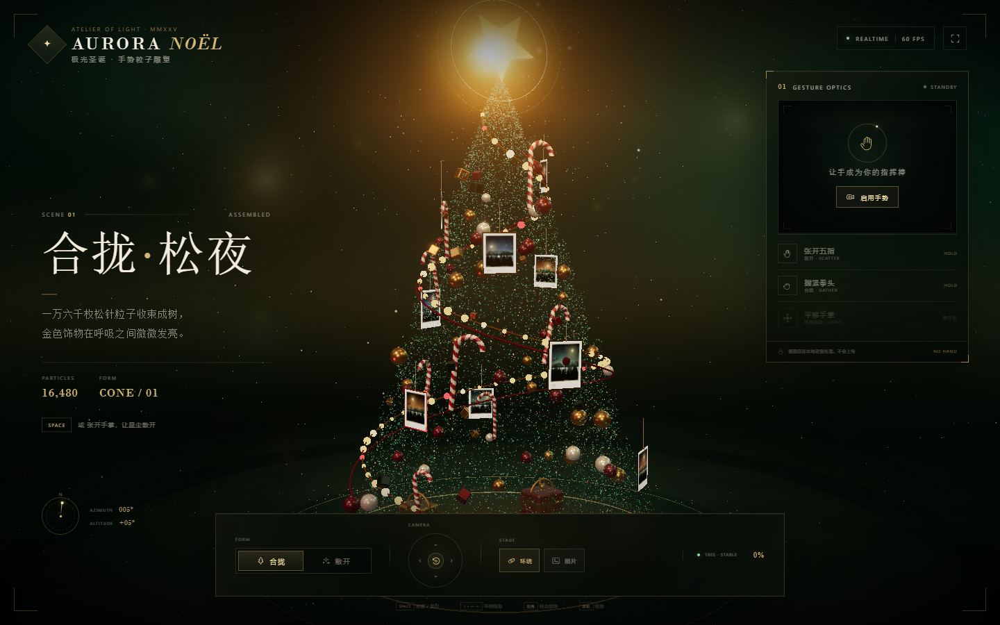
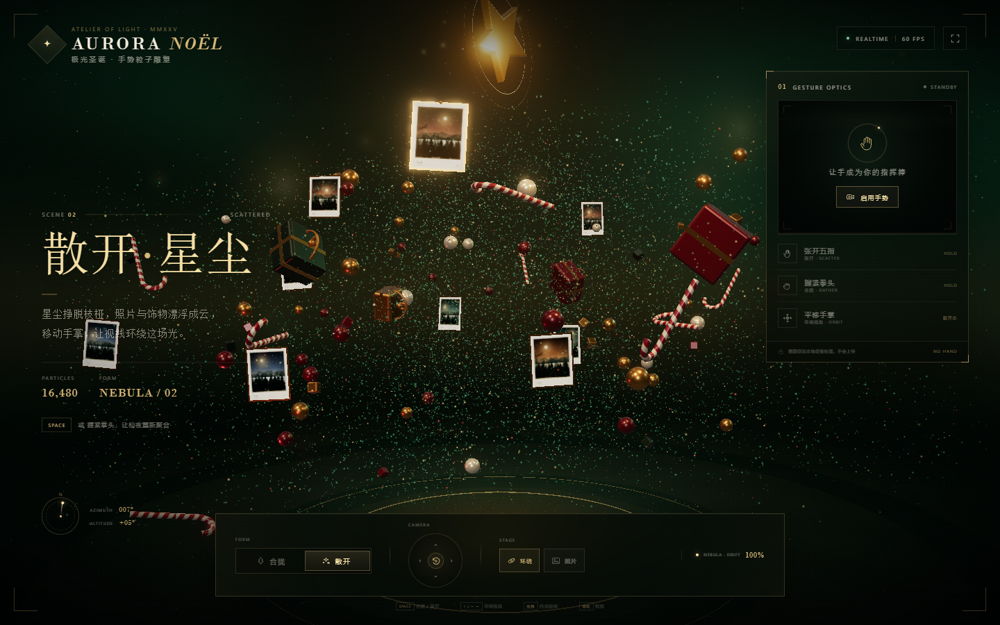

# Aurora Noël · 手势粒子圣诞树

一场由手掌控制的立体光影雕塑：16,480 枚松针粒子、金属金与圣诞红饰物、糖果棍和照片云，在**合拢的圣诞树**与**散开的星尘**之间平滑流动。





## 快速运行

```bash
cd gesture-xmas
npm install
npm run dev
```

打开 **http://127.0.0.1:4173**，在右侧「GESTURE OPTICS」面板点击 **启用手势**，允许浏览器访问摄像头即可。

生产构建：

```bash
npm run build
npm run preview
```

> 摄像头需要在 `localhost` 或 HTTPS 下使用。推荐桌面版 Chrome / Edge；浏览器会提示一次摄像头权限。

## 手势

| 手势 | 作用 | 反馈 |
| --- | --- | --- |
| 张开五指，保持约 0.6 秒 | 合拢态 → 散开态 | 取景框下沿的金色进度条走满，星尘爆开 |
| 握紧拳头，保持约 0.6 秒 | 散开态 → 合拢态 | 星尘重新聚合为圣诞树 |
| 散开态下平移手掌 | 环绕旋转镜头 | 右上角轨迹和左下角方位仪同步变化 |
| 手离开画面 | 暂停手势环绕 | 自动恢复缓慢的舞台环绕 |

摄像头画面只在本机浏览器内处理，不会上传。

### 图形化控制与备用操作

- 底部控制台：合拢 / 散开切换、四向镜头箭头、重置视角、自动环绕、上传照片、全屏
- 键盘：`Space` 合拢 / 散开，`↑ ↓ ← →` 环绕，`R` 重置视角，`F` 全屏
- 鼠标 / 触控：拖拽旋转、滚轮或双指缩放
- 照片：点击「照片」按钮，或直接把图片拖入页面；上传的照片会替换照片云中的默认照片

## 视觉与交互细节

- **主色系**：哑光松绿粒子、金属金饰物与星星、深红圣诞球和糖果棍
- **电影感**：ACES 色调映射、选择性辉光、星芒光晕、层叠雾化光斑、金色地面光环
- **元素构成**：粒子树体、金属球、圆角正方体、条纹糖果棍、拍立得照片云、礼物盒与顶部金色五角星
- **状态过渡**：2.6 秒时间轴缓动；每枚粒子有独立的延迟与漂移，饰物有独立的飞行弧线与旋转惯性
- **响应式**：桌面三栏式舞台、移动端紧凑控制台与自动构图

## 分享给别人

**只发源码文件夹 → 对方需要 Node.js。** 对方要安装 Node、运行 `npm install` 与 `npm run dev`，不适合非技术用户。

不需要 Node 的两种分享方式：

### 1. 发一个网页链接（推荐，跨平台）

`npm run build` 后，把 `dist/` 里的**全部内容**上传到任意静态托管（Netlify Drop、Vercel、Cloudflare Pages 等），把 HTTPS 链接发给对方即可。对方只需要浏览器。

也可以直接使用已经打好的 `share/Aurora-Noel-Website.zip`：解压后把 `index.html` 所在的这一层拖到 [Netlify Drop](https://app.netlify.com/drop)，获得一条链接。

### 2. Windows 免安装版

发送 `share/Aurora-Noel-Windows.zip`。对方解压后双击 `Start Aurora Noel.bat`，脚本会用 Windows 自带的 PowerShell 在本地启动服务并打开浏览器。不需要 Node、Python 或安装任何运行环境。

> 因为摄像头与 WebAssembly 需要安全上下文，不能直接双击 `index.html`；必须通过 `localhost` 或 HTTPS 打开。Windows 包已内置本地微型服务器，静态网页包则通过托管服务的 HTTPS 链接访问。

## 技术栈

- Three.js `0.187`
- `@mediapipe/tasks-vision` HandLandmarker（WASM 与模型均本地托管，无 CDN 依赖）
- Vite `8`
- 原生 Canvas 生成照片纹理与发光贴图

核心文件：

```text
src/main.js       状态机、2.6s 过渡、键盘/手势/照片交互
src/stage.js      渲染器、镜头、后期辉光、背景与地面
src/tree.js       粒子 shader、饰物、糖果棍、照片云、星星
src/gestures.js   MediaPipe 初始化、手部骨架、手势分类与保持判定
src/ui.js         面板、状态、镜头读数与图形化控件
public/models/    hand_landmarker.task
public/mediapipe/ MediaPipe WASM
```

## 本地校验

```bash
node scripts/test-classifier.mjs
```

合成手掌关键点测试会验证「张开 ≥ 4 指」与「握拳 ≤ 1 指」的判断，不需要浏览器或摄像头。

## 许可

仅用于演示与创作。MediaPipe Hand Landmarker 模型遵循其原始许可。
